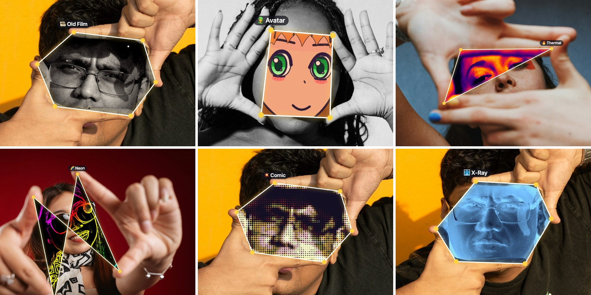

# Pinch Portal — your fingers open a portal into an anime world

A webcam filter that runs entirely in your browser. Frame part of the picture with your **thumb and pointer
finger** (one hand makes a triangle, two hands make a frame, flip a hand to cross the lines) and everything inside
the shape is redrawn live — including **🌸 Anime**, a small neural network that turns you and your room into an
anime drawing at ~30+ fps.



<sub>Captured from the app itself, fed still photos instead of a webcam: the hand tracker finds the fingertips and
the effect (Old Film, Avatar, Thermal, Neon, Comic, X-Ray) is drawn only inside the shape. A flipped hand crosses the
lines (Neon); a two-hand "director's frame" makes a six-sided frame. Photos from Unsplash (see credits).</sub>

Nothing is uploaded: the camera, hand/face tracking and the anime models all run locally in the browser (WebGPU).

## Run it

```bash
python3 -m http.server 8123
```

Open <http://localhost:8123> in a recent Chrome, Edge or Safari (WebGPU needed for full speed), click
**Start camera**, hold up your hand and pick a filter. Keys: ← / → switch filters, Space saves a photo,
F toggles the dedicated face model in Anime mode.

## How the anime filter works

Real anime filters (e.g. Snapchat's) redraw the whole frame with a neural network. This project builds one from
scratch with **teacher → student distillation**:

1. **Teacher (slow, high quality, offline).** Stable Diffusion 1.5 with an anime model (Counterfeit V3) and
   ControlNets redraws thousands of photos of people as anime:
   - a *lineart* ControlNet keeps the layout, released partway through so it can draw anime proportions;
   - for face close-ups, a *MediaPipe-face* ControlNet locks the **mouth and jaw** to the real expression
     (eyes are left free so they come out as big anime eyes); without it the teacher turned neutral faces into
     frowns and screams, which made learned mouths a blur;
   - a face-detail pass redraws small faces zoomed in; the photo's real hair/skin/clothes colours are restored
     afterwards (eyes keep anime colours) and harsh shading is softened.
2. **Students (fast, live in the browser).**
   - `models/anime_student.onnx` — the scene model (448×336 crop around your finger frame, upscaled 2× on the GPU
     with Anime4K).
   - `models/anime_face.onnx` — a dedicated face model: the face is cut out upright at 256×256 with eyes and mouth
     at fixed positions, redrawn, warped back and blended in. Trained with the mouth weighted 6×.

   Both are small U-Nets trained with L1 + VGG perceptual + edge (line) losses, a PatchGAN critic, and an
   anti-flicker loss (a slightly shifted / noisier copy of each frame must be drawn the same way).

### In the browser
`index.html` is a single page (no build step): MediaPipe hand + face tracking, onnxruntime-web on WebGPU, and the
crop/resize/normalise and drawing steps as WGSL shaders so frames never leave the GPU. The face model runs every
frame and the scene model every other frame (~26 ms per frame on an M4 MacBook).

## Training it yourself

Everything is in [`teacher/`](teacher). It was run on a Linux desktop with an RTX 3070 (8 GB); a full pipeline is
a few days of unattended GPU time. Rough order:

| Step | Script |
|---|---|
| Set up the Python env (CUDA or ROCm) | `teacher/setup_linux.sh` |
| Download a subset of HaGRID (people in front of webcams) | `fetch_data.py`, `fetch_originals.py` |
| Face close-ups | `make_faces.py` |
| Teacher redraws | `generate_pairs_v7.py` (scenes), `teacher_face.py --mouth-only` (faces) |
| Colours / lighting / face alignment | `fix_colors.py`, `align_faces.py`, `make_mouths.py` |
| Train students | `train.py` (scene), `train_hr.py` (2× scene, experimental), `train_face.py` (face) |
| Export for the browser | `export_onnx.py <checkpoint> <out.onnx> --fp16` |

The `run_*.sh` scripts are the exact unattended runs used (they resume after interruptions).
`compare_teachers.py` / `styles.py` were used to pick the teacher.

## Status

Experimental and still improving. Faces are the weak spot: the face model keeps your real expression but is still
softer and less stylised than hand-drawn anime. Dataset diversity is limited (HaGRID volunteers were mostly from one
region).

## Credits and licences

- **Code** in this repository: MIT — see [LICENSE](LICENSE).
- **Models** (`models/*.onnx`): see [MODELS_LICENSE.md](MODELS_LICENSE.md) — trained on images derived from
  HaGRID (CC BY-SA 4.0 variant) and generated with CreativeML OpenRAIL-M models.
- Training photos: [HaGRID / HaGRIDv2](https://github.com/ai-forever/hagrid) by ai-forever (SberDevices),
  licence: a variant of CC BY-SA 4.0. Photos are not redistributed here.
- Teacher: [Counterfeit V3](https://huggingface.co/stablediffusionapi/counterfeit-v30) (CreativeML OpenRAIL-M),
  [ControlNet lineart](https://huggingface.co/lllyasviel/control_v11p_sd15_lineart),
  [ControlNetMediaPipeFace](https://huggingface.co/CrucibleAI/ControlNetMediaPipeFace) (OpenRAIL),
  [LCM-LoRA](https://huggingface.co/latent-consistency/lcm-lora-sdv1-5), [TAESD](https://huggingface.co/madebyollin/taesd).
- Demo photos ([Unsplash License](https://unsplash.com/license)): Zoshua Colah, Brooke Balentine, Sonja Prein and
  Valeriano Escobar on [Unsplash](https://unsplash.com).
- In the browser: [MediaPipe Tasks](https://developers.google.com/mediapipe) (Apache 2.0),
  [onnxruntime-web](https://github.com/microsoft/onnxruntime) (MIT),
  [Anime4K-WebGPU](https://github.com/Anime4KWebBoost/Anime4K-WebGPU) (MIT).
